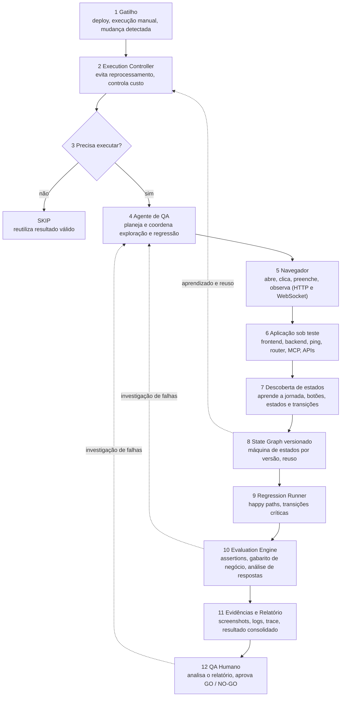

# qa-agente

Réplica interna do desenho "Fluxo do Agente de QA Autônomo – BOT-7526" (descoberta, teste, validação e evidências com
controle de custo), com o motor de decisão em cada ponto onde há escolha com custo e incerteza.

Projeto separado do Vigia. O Vigia só fornece dados de QA (sementes `qa_*`, schema `vigia_novo`); este projeto não
escreve no acervo dele.

## Fluxo (12 passos do desenho)



## Passo do desenho → módulo

| Passo | Módulo (`src/`) | Estado |
|---|---|---|
| 1 Gatilho | `modelos.rs` (`Gatilho`) | pronto |
| 2 e 3 Execution Controller e "Precisa executar?" | `controlador.rs` | pronto, com o motor como contraponto |
| 4 Agente de QA (Strands + LLM) | `portas.rs` (`AgenteQA`) | só a porta, sem implementação |
| 5 e 6 Navegador e aplicação | `portas.rs` + `navegador_chrome.rs` | pronto, Chrome real via CDP (sem Playwright); aplicação de teste em `fixtures/app.html` |
| 7 e 8 Descoberta de estados e State Graph | `exploracao.rs` + `grafo_estados.rs` | pronto, busca em largura com limite de cliques |
| 9 Regression Runner | `regressao.rs` | pronto |
| 10 Evaluation Engine | `avaliacao.rs` | pronto |
| 11 Evidências e Relatório | `evidencias.rs` | pronto |
| 12 QA Humano GO / NO-GO | `gate_humano.rs` | pronto, com abstenção |
| Motor de decisão | `motor.rs` | cliente de `POST /v1/opiniao`; o rótulo está desligado |

## Onde o motor decide

- **Passos 2 e 3:** executar, pular ou bloquear. A opinião do motor vem de `/v1/opiniao` e entra como contraponto: a
  regra do controlador decide, e a divergência é registrada na decisão.
- **Passo 4:** explorar × aproveitar (ainda sem implementação, depende do agente).
- **Passo 8:** peso do reuso pela confiança acumulada (`execucoes_efetivas` por estado).
- **Passo 12:** o motor se abstém quando não tem base (`sem veredito`), e só nesse caso o relatório vai ao humano
  com marca de incerteza.

## Dados de QA

A pesquisa do Vigia roda por sementes `qa_*` (`vigia/app/seeds/`), uma por tema do desenho: agente autônomo, grafo de
estados, regressão e avaliação, seleção e custo de testes, evidências e GO/NO-GO, Playwright e MCP.

## Rótulos do motor

`motor::rotular` só monta o comando em modo de ensaio (`ensaio = true`). Os tipos de decisão deste projeto ainda não estão
entre os tipos estáveis do livro de produção, e só entram nele com ordem do Daniel.

## Rodar os testes

```
cargo test
```

Teste de ponta a ponta com Chrome real (passos 2 a 12 contra `fixtures/app.html`), que fica fora do `cargo test` normal:

```
cargo test -- --ignored
```

Ele grava a captura em `target/qa-evidencias/`. Os alvos reais (painel do Vigia, dnd-mestre, managerportal) ainda não
foram ligados: o painel do Vigia sobe com `.env` de banco real, então fica para uma rodada com banco descartável.

## Usar em outro projeto (CLI)

Um arquivo JSON por alvo; o mesmo executável serve ao jogo, ao painel do Vigia, ao managerportal e ao motor de decisão.

```
cargo run --release -- alvo.json      # exige QA_OMNIROUTE_CHAVE; saida em qa-saida/<nome>/
```

```json
{
  "nome": "dnd-mestre",
  "url": "http://127.0.0.1:5173",
  "objetivo": "Criar uma campanha cujo nome comece com 'E2E ' e começar a criar o personagem",
  "modo": "generico",
  "limite_passos": 15,
  "sondas": [{ "nome": "saude", "url": "http://127.0.0.1:8787/saude", "status": 200 }],
  "cookie": { "nome": "sessao", "valor": "<sessao de teste>", "dominio": "127.0.0.1" }
}
```

- `modo`: `generico` lê título e botões/links/campos do DOM; `data-acao` serve a app que expõe `data-estado` e `data-acao`.
- O modo genérico nunca clica rótulos como excluir, apagar, remover, sair e logout (`evitar`, configurável), e nunca preenche campo de senha.
- Código de saída: 0 verde, 1 com falhas, 2 erro de uso, configuração ou agente (inclusive cota do OmniRoute esgotada: aí para, sem completar por inferência).
- Use só contra ambiente local ou descartável, com sessão de teste. Nunca aponte para produção.

## O backend entra no relatório

O navegador registra todo status HTTP que o backend devolveu, as requisições que nem chegaram e os erros de console;
`sondas` fazem GET de saúde antes e depois. **5xx e requisição sem resposta reprovam o relatório** mesmo com as telas
verdes; 4xx e erro de console aparecem como informação. A URL no relatório perde a query string (pode ter token).

## Testar com o jogo (dnd-mestre)

`tools/jogo-ambiente.mjs` (cola em Node, exceção declarada à regra "Rust sempre") sobe o ambiente E2E do próprio jogo:
banco `dnd_teste`, schema descartável, narrador falso e login de teste. O teardown do jogo só apaga o schema se as
campanhas começarem com "E2E ": por isso o objetivo do agente manda nomear a campanha assim.

```
cargo test --test jogo_dnd_mestre -- --ignored --nocapture
```

## Front e back no mesmo relatório

`qa-saida/<alvo>/relatorio.json` junta, na mesma rodada:

| Lado | O que entra | Reprova? |
|---|---|---|
| Front | captura de cada passo, erros de console | não |
| Back, HTTP | status de cada requisição | 5xx e requisição sem resposta reprovam; 4xx é informação |
| Back, WebSocket | frames enviados e recebidos, nomes dos eventos Socket.IO (nunca o conteúdo), erros de frame | erro de frame reprova |
| Back, log | linhas novas do `log_servidor` durante o QA | exceção não tratada, fatal e panic reprovam; "error" simples é aviso |
| Back, estado | `verificacoes`: GET somente-leitura com a sessão do alvo (ex.: a campanha criada está em `/api/campanhas`) | status errado ou trecho ausente reprova |
| Back, saúde | `sondas` GET antes e depois | status diferente do esperado reprova |

Se `log_servidor` está configurado mas o arquivo não existe, o relatório diz `"lido": false` e avisa na saída: sem log,
"nenhum erro grave" não prova nada. O servidor de teste do jogo não escreve em stdout, então no jogo o log fica cego.
Quando a escolha do agente sai malformada, a jornada para e registra `parou_por` em vez de perder o que já foi feito.

## Ações que o modo genérico entende

| Ação | Quando aparece |
|---|---|
| texto do botão, link, aba ou item de menu | clicável visível |
| `Preencher: <campo> = <texto>` | campo de texto (rótulo vem de `aria-label`, `placeholder`, `<label>` ou texto vizinho; nunca senha) |
| `Marcar: <rótulo>` | caixa de marcar ou botão de rádio (clicar de novo desmarca) |
| `Selecionar: <lista> = <opção>` | `<select>` (até 12 opções por lista) |

A escolha vem do LLM e é sempre validada contra a lista de opções. Se o modelo erra a escolha, a jornada segue com a
primeira opção sem texto (marcada `fallback-deterministico` nos insumos) por até 3 vezes seguidas e depois para.
Cada opção some da lista depois de 2 tentativas na mesma tela. O prompt tem orçamento de 5500 caracteres (o gateway
recusa mais de 6000). Veja `docs/historico-de-rodadas-no-jogo.md` e `docs/insumos-pesquisa-qa.md`.

## Aprendizado por reforco (`aprendizado.rs`, `qa-aprende`)

Q-learning tabular que aprende com os logs das rodadas e com a propria execucao.

- **Estado** = tela abstraida (sem contador colado ao nome: `Identidade6` -> `Identidade`; a etapa `N ...` e mantida).
  **Acao** = opcao sem o texto digitado. **Recompensa** = progresso: tela nova na execucao (+1), etapa do assistente que
  bate o recorde (+2 por etapa), passo que nao muda a tela (-0,5), recuo de etapa (-1 por etapa). Avancar de novo uma etapa
  ja alcancada nao paga (senao voltar e avancar viraria moedeiro), e recuar zera o valor futuro da acao.
- **Uso na jornada:** o `conselho` (o que deu certo, o que desfez progresso e o que nunca foi tentado naquela tela) entra no
  prompt; quando a tela nao muda 3 passos seguidos, a escolha passa a ser da politica por UCB (`politica-ucb` no relatorio).
  Cada passo atualiza a tabela na hora; `qa-politica.json` e salvo a cada 5 passos e no fim (`QA_POLITICA` muda o caminho).
- **Treino offline:** `qa-aprende [--politica arq] [--epocas 30] [--banco] <log>...` le `passos.jsonl` ou a saida de texto das
  rodadas, acumula na politica salva e, com `--banco`, espelha em `qa_agente.politica`. O `n` mostrado conta as repeticoes das epocas.
- **Rastro ao vivo** (`rastro.rs`): cada passo vai para stdout, `passos.jsonl`, `checkpoint.json` e `qa_agente.execucao/passo`.

## Backend no aprendizado, rodizio de modelos, reinicio do Chrome e politica confiante

- **Efeito no backend** (`efeito.rs`): cada passo guarda o que causou no servidor (rotas de API `2xx /api/x/{id}`, eventos de
  WebSocket, 5xx/4xx, falhas de rede/console/ws), pela diferenca entre a observacao antes e depois do clique. A recompensa paga
  rota/evento novo (mesmo sem a tela mudar) e erro novo do servidor (achado de QA, uma vez por assinatura). O historico do
  prompt traz `[back: ...]`, e o efeito vai no `passos.jsonl` e em `qa_agente.passo.efeito` (jsonb).
- **Rodizio de modelos** (`omniroute.rs`): cada chamada comeca por um modelo diferente do pool (8 modelos `cfp/*` rapidos e sem
  raciocinio); quem falha fica 1 min fora do rodizio (5 min se for cota); `QA_OMNIROUTE_MODELOS` troca o pool.
- **Navegador que cai:** a jornada sobe um Chrome novo (mesma sessao e mesmo coletor de backend) e recomeca da URL inicial, ate
  `MAX_REINICIOS` (5); depois disso devolve os passos ja feitos com `erro do navegador`, nunca perde a rodada.
- **Politica confiante:** com `N_MIN_CONFIANTE` visitas, `Q_MIN_CONFIANTE` e folga `MARGEM_CONFIANTE` sobre a segunda opcao, a
  politica escolhe sem chamar o LLM (campo de texto nunca); a cada 5a decisao confiante o LLM e consultado mesmo assim
  (auditoria). O treino offline so conta visitas na primeira epoca.
