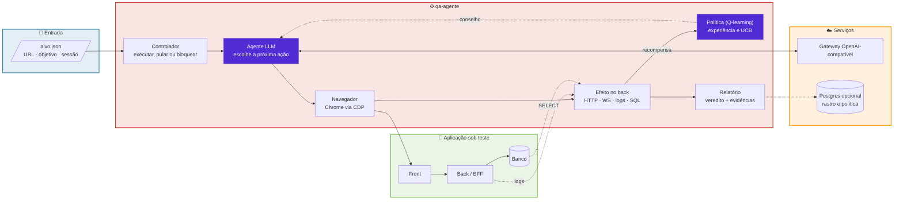

<div align="center">


<br/><br/>


<br/><br/>


</div>

---

Um **agente de QA autônomo em Rust**. Você descreve o alvo num arquivo JSON (URL, objetivo, sessão de teste), e o agente
abre um Chrome de verdade, explora a aplicação escolhendo o próximo clique com um LLM, e entrega um relatório que junta,
na mesma rodada, o que viu no **front** e o que aconteceu no **back**: respostas HTTP, eventos de WebSocket, logs do
servidor e o estado gravado no banco.

🎯 **Dois princípios:** o agente **nunca** executa texto livre do modelo (a escolha é sempre validada contra as opções
visíveis na tela) e **nunca** dá a rodada por boa sem prova: o veredito "verde" só quer dizer *sem falha encontrada*, e o
relatório diz quando o objetivo **não** foi cumprido.

### 🚀 Início rápido

```bash
cargo build --release

# qualquer gateway com /v1/chat/completions (OpenAI-compatível)
export QA_OMNIROUTE_URL=http://localhost:<porta-do-gateway>
export QA_OMNIROUTE_CHAVE=<sua-chave>

cargo run --release -- alvos/exemplo.json   # saída em qa-saida/<nome-do-alvo>/
```

Precisa de Chrome ou Chromium instalado. Use **só contra ambiente local ou descartável, com sessão de teste**. Nunca
aponte para produção.

### 🗺️ Mapa do repositório

| | O que você procura | Onde está |
|---|---|---|
| 🧩 | Descrever um alvo | [`alvos/exemplo.json`](alvos/exemplo.json) e a seção [Alvos](#alvos) |
| 🧠 | O laço do agente (escolher, clicar, observar) | [`src/exploracao.rs`](src/exploracao.rs), [`src/agente_llm.rs`](src/agente_llm.rs) |
| 🌐 | Chrome via CDP, ações e coleta de rede | [`src/navegador_chrome.rs`](src/navegador_chrome.rs), [`src/observacao.rs`](src/observacao.rs) |
| 🔬 | Efeito de cada passo no back | [`src/efeito.rs`](src/efeito.rs), [`src/log_servidor.rs`](src/log_servidor.rs), [`src/consultas_sql.rs`](src/consultas_sql.rs) |
| 🎓 | Aprendizado por reforço | [`src/aprendizado.rs`](src/aprendizado.rs), [`src/bin/qa-aprende.rs`](src/bin/qa-aprende.rs) |
| 📝 | Relatório, evidências e GO/NO-GO | [`src/evidencias.rs`](src/evidencias.rs), [`src/gate_humano.rs`](src/gate_humano.rs) |
| 📚 | O que cada rodada ensinou | [`docs/`](docs/) |

### 🧬 Arquitetura em 30 segundos



---

## Sumário

- [Como o agente trabalha](#como-o-agente-trabalha)
- [Alvos](#alvos)
- [Ações que o modo genérico entende](#ações-que-o-modo-genérico-entende)
- [Front e back no mesmo relatório](#front-e-back-no-mesmo-relatório)
- [Segurança e limites](#segurança-e-limites)
- [Aprendizado por reforço](#aprendizado-por-reforço)
- [Resiliência e custo](#resiliência-e-custo)
- [Rastro e banco](#rastro-e-banco)
- [Configuração](#configuração)
- [Testes](#testes)
- [Estrutura do projeto](#estrutura-do-projeto)
- [Estado atual e limites conhecidos](#estado-atual-e-limites-conhecidos)
- [Contribuindo](#contribuindo)

---

## Como o agente trabalha

1. **Abre** a URL do alvo num Chrome headless (janela de desktop, 1366×900) e injeta a sessão de teste.
2. **Lê a tela:** o modo genérico extrai título, botões, links, abas, campos, caixas de marcar e listas.
3. **Escolhe** a próxima ação: o LLM recebe o objetivo, a tela, o histórico e as opções; a resposta é validada contra a
   lista. Se o modelo erra, a jornada segue com uma escolha determinística, marcada como tal.
4. **Clica** e mede o que aconteceu: a tela mudou? O que o back respondeu? Apareceu erro novo em algum log?
5. **Aprende:** cada passo vira uma transição (tela, ação, destino, efeito no back) e atualiza a política.
6. **Para** quando o objetivo é cumprido, quando as opções acabam (cada opção some da lista após 2 tentativas na mesma
   tela) ou quando o gateway recusa por cota (a rodada termina com relatório parcial, nunca "completa por inferência").

## Alvos

Um arquivo JSON por alvo; o mesmo executável serve a qualquer aplicação web.

```json
{
  "nome": "meu-app",
  "url": "http://localhost:3000",
  "objetivo": "Explorar as telas principais como um usuário novo, sem criar, editar nem apagar nada.",
  "limite_passos": 30,
  "acoes_de_escrita": "salvar|enviar|aprovar|excluir",
  "max_escritas": 0,
  "sondas": [{ "nome": "front", "url": "http://localhost:3000" }],
  "cookie": { "nome": "sessao", "valor": "<token-de-teste>", "dominio": "localhost", "http_only": true },
  "logs": [{ "nome": "servidor", "caminho": "/caminho/do/servidor.log" }],
  "consultas_sql": [
    { "nome": "registros por status", "container": "meu-banco", "banco": "meu_db",
      "sql": "SELECT status, count(*) FROM pedidos GROUP BY status ORDER BY 1", "depois_contem": "" }
  ]
}
```

| Campo | Para quê |
|---|---|
| `modo` | `generico` (padrão) lê o DOM; `data-acao` serve a app que expõe `data-estado` e `data-acao` |
| `evitar` | rótulos que nunca são clicados (padrão: excluir, apagar, remover, sair, logout…) |
| `limite_passos` | teto de passos; `0` = sem limite (o agente decide quando parar) |
| `acoes_de_escrita` + `max_escritas` | rótulos que contam como escrita e o máximo por rodada; **vale para qualquer escolhedor** (LLM, política e fallback) |
| `sondas` | `GET` de saúde antes e depois da jornada |
| `cookie` | sessão de teste; `http_only: false` quando o front lê a sessão por JavaScript |
| `contexto_ao_llm` | manda o texto visível da tela ao LLM (**desligado por padrão**; veja [Segurança](#segurança-e-limites)) |
| `logs` | logs do servidor (back, BFF, front…) lidos a **cada passo** |
| `log_servidor` | um log lido uma vez no fim, para o relatório |
| `verificacoes` | `GET` somente-leitura do estado do back depois da jornada, com a sessão do alvo |
| `consultas_sql` | `SELECT` somente-leitura antes e depois, dentro do container do banco |

**Código de saída:** `0` verde, `1` com falhas, `2` erro de uso, de configuração ou do agente (inclusive cota do gateway
esgotada).

## Ações que o modo genérico entende

| Ação | Quando aparece |
|---|---|
| texto do botão, link, aba ou item de menu | clicável visível |
| `Preencher: <campo> = <texto>` | campo de texto (rótulo de `aria-label`, `placeholder`, `<label>` ou texto vizinho; nunca senha) |
| `Marcar: <rótulo>` | caixa de marcar ou botão de rádio (clicar de novo desmarca) |
| `Selecionar: <lista> = <opção>` | `<select>` (até 12 opções por lista) |

O prompt tem orçamento de 5.500 caracteres (gateways costumam recusar acima de 6.000): se estoura, encurta primeiro o
histórico, depois o texto da tela e por último a lista de opções.

## Front e back no mesmo relatório

`qa-saida/<alvo>/relatorio.json` junta, na mesma rodada:

| Lado | O que entra | Reprova? |
|---|---|---|
| Front | captura de cada passo, erros de console | não |
| Back, HTTP | status de cada requisição que o navegador fez | 5xx e requisição sem resposta reprovam; 4xx é informação |
| Back, WebSocket | frames enviados e recebidos, nomes dos eventos Socket.IO (nunca o conteúdo), erros de frame | erro de frame reprova |
| Back, logs | linhas novas dos `logs` durante o QA | exceção não tratada, fatal e panic reprovam; "error" simples é aviso |
| Back, estado | `verificacoes` (HTTP) e `consultas_sql` (antes e depois do dado gravado) | status errado, trecho ausente ou resultado diferente do esperado reprovam |
| Saúde | `sondas` antes e depois | status diferente do esperado reprova |

Cada passo também guarda seu **efeito no back** (`[back: 2xx /api/pedidos/{id}, ws ↑turno]`): o agente enxerga o que o
servidor fez, e o aprendizado usa isso como sinal. Se um log está configurado mas o arquivo não existe, o relatório diz
`"lido": false`: sem log, "nenhum erro grave" não prova nada.

## Segurança e limites

- **Nunca clica** rótulos da lista `evitar` e **nunca preenche** campo de senha.
- **Limite de escrita por rodada** (`acoes_de_escrita` + `max_escritas`): ao atingir o máximo, as opções de escrita
  somem da lista para **todos** os escolhedores. O objetivo em texto só restringe o LLM; a política exploraria o que
  nunca tentou e ignoraria um "no máximo duas decisões" escrito no objetivo.
- **SQL somente-leitura:** só `SELECT`, `SHOW` e `DESCRIBE`, uma instrução, sem palavra de escrita; se uma consulta do
  alvo escreve, o alvo inteiro é recusado antes de qualquer coisa rodar. A senha do banco vem do próprio container.
- **Privacidade:** os rótulos das opções vão ao gateway de LLM. Com `contexto_ao_llm: false` (padrão) o texto da tela
  não vai, mas os rótulos de botões e links ainda vão. Use dados fictícios, ou um gateway que você controla.
- **A URL no relatório perde a query string** (pode ter token).

## Aprendizado por reforço

Q-learning tabular que aprende com os logs das rodadas e com a própria execução (`aprendizado.rs`).

| Sinal | Recompensa |
|---|---|
| Tela nova na execução | + |
| Etapa de assistente (wizard) que bate o recorde | + por etapa |
| Rota de API ou evento de WebSocket novo | + (mesmo sem a tela mudar) |
| Erro novo do servidor (achado de QA) | + uma vez por assinatura |
| Passo que não muda a tela | − , e **cada passo parado seguido custa mais** |
| Voltar a uma tela já vista | − |
| Repetir o mesmo par (tela, ação) | − crescente |
| Recuar de etapa | − por etapa, e o recuo zera o valor futuro da ação |

As regras de custo existem para o agente **não farmar recompensa**: ficar parado, girar em círculos ou voltar e avançar
de novo só perde.

- **Estado** = tela abstraída (sem o contador colado ao nome: `Passo6` → `Passo`); **ação** = opção sem o texto digitado.
- **Conselho no prompt:** o que deu certo, o que desfez progresso e o que nunca foi tentado naquela tela.
- **Quando a tela não muda por 3 passos**, a escolha passa para a política por UCB (`politica-ucb` no relatório).
- **Política confiante:** com visitas suficientes, valor alto e folga sobre a segunda opção, a política escolhe **sem
  chamar o LLM**; a cada 5ª decisão confiante o LLM é consultado mesmo assim (auditoria). Campo de texto nunca.
- **Treino offline:** `qa-aprende [--politica arq] [--epocas 30] [--banco] <log>...` lê `passos.jsonl` ou a saída de
  texto das rodadas e acumula na política salva. Só a primeira época conta visitas.

## Resiliência e custo

- **Rodízio de modelos:** cada chamada começa por um modelo diferente do pool (8 modelos rápidos e sem raciocínio);
  quem falha fica 1 minuto fora do rodízio (5 se for cota). `QA_OMNIROUTE_MODELOS` troca o pool.
- **Chrome que cai:** a jornada sobe um navegador novo (mesma sessão, mesma coleta do back) e recomeça da URL inicial,
  até 5 vezes; depois devolve os passos já feitos com `erro do navegador`.
- **Erro grave do agente ou cota:** relatório parcial, nunca perda da rodada.
- **Custo por passo** (modelo, tokens) vai no rastro e nos insumos; passos da política custam 0 token.

## Rastro e banco

Cada passo é gravado **na hora** em `stdout`, `passos.jsonl` e `checkpoint.json` (onde parou). Opcionalmente também num
Postgres (`qa_agente.execucao`, `passo` e `politica`), via `docker exec`:

| Variável | Padrão |
|---|---|
| `QA_RASTRO_BANCO` | `desligado` mantém só o arquivo |
| `QA_RASTRO_CONTAINER` | `postgres-rag` |
| `QA_RASTRO_USUARIO` | `raguser` |
| `QA_RASTRO_BD` | `rag_ecosystem` |

Se o banco não responde, o rastro em arquivo segue e o aviso sai no `stdout`.

## Configuração

| Variável | Para quê |
|---|---|
| `QA_OMNIROUTE_CHAVE` | **obrigatória**: chave do gateway OpenAI-compatível |
| `QA_OMNIROUTE_URL` | URL do gateway (padrão: porta local do gateway) |
| `QA_OMNIROUTE_MODELOS` | pool de modelos separado por vírgula |
| `QA_POLITICA` | caminho do `qa-politica.json` (padrão: pasta atual) |

## Testes

```bash
cargo test                       # testes unitários, sem rede nem Chrome
cargo test -- --ignored          # exigem Chrome e, em alguns, o ambiente de cada alvo
```

Os testes com Chrome usam as páginas de [`fixtures/`](fixtures/) (aplicação mínima e formulário com `label`, caixa de
marcar e `select`), onde `Marcar` e `Selecionar` provam que o valor realmente muda.

## Estrutura do projeto

```text
qa-agente/
├── src/
│   ├── main.rs              CLI: qa-agente <alvo.json>
│   ├── bin/qa-aprende.rs    treino offline da política
│   ├── exploracao.rs        o laço: escolher, clicar, observar, aprender
│   ├── agente_llm.rs        prompt, validação da escolha, tentativas
│   ├── navegador_chrome.rs  Chrome via CDP, ações, reinício
│   ├── observacao.rs        HTTP, WebSocket e console do navegador
│   ├── efeito.rs            o que cada passo causou no back
│   ├── log_servidor.rs      logs do servidor (final e a cada passo)
│   ├── consultas_sql.rs     SELECT somente-leitura antes e depois
│   ├── aprendizado.rs       Q-learning, recompensa, UCB, política confiante
│   ├── rastro.rs            registro ao vivo (arquivo e banco)
│   ├── grafo_estados.rs     máquina de estados versionada
│   ├── regressao.rs · avaliacao.rs · evidencias.rs · gate_humano.rs
│   └── controlador.rs · insumos.rs · sondas.rs · verificacoes.rs · …
├── alvos/exemplo.json       alvo de exemplo
├── fixtures/                páginas de teste
├── tests/                   testes com Chrome e ponta a ponta
├── tools/                   cola de ambiente (Node/shell) para os exemplos
└── docs/                    o que as rodadas ensinaram
```

## Estado atual e limites conhecidos

Honestidade primeiro: o agente explora, observa front e back, e registra tudo, mas **ainda não conclui fluxos longos**
(um assistente de criação com muitas etapas costuma parar no meio). O que existe de medição está nos documentos
de [`docs/`](docs/).

- Falta uma **medição com bugs plantados** para dizer quantos defeitos reais ele acha (hoje se mede passos, telas e
  tokens, não defeitos).
- O oráculo é fraco: sem expectativas de comportamento por critério de aceite, ele acha **quedas e erros**, não bug
  funcional; as `consultas_sql` com `depois_contem` são o primeiro passo nessa direção.
- A política aprendida num app pode empurrar escolhas em outro app (ex.: preferir `Marcar`); telas novas caem no palpite.
- O veredito "verde" ainda não considera o objetivo: o relatório avisa, mas o rótulo deveria ser "incompleto".

## Contribuindo

- Rust 2021; `cargo test` verde antes de qualquer PR.
- Mudança de comportamento do agente leva teste que prove **o efeito**, não só que compila.
- Não inclua alvos reais, sessões, logs ou políticas treinadas com telas de sistemas de terceiros: o `.gitignore` já
  cobre `alvos/*` (exceto o exemplo) e `qa-politica.json`.

## Licença

[MIT](LICENSE) © Daniel Porto
